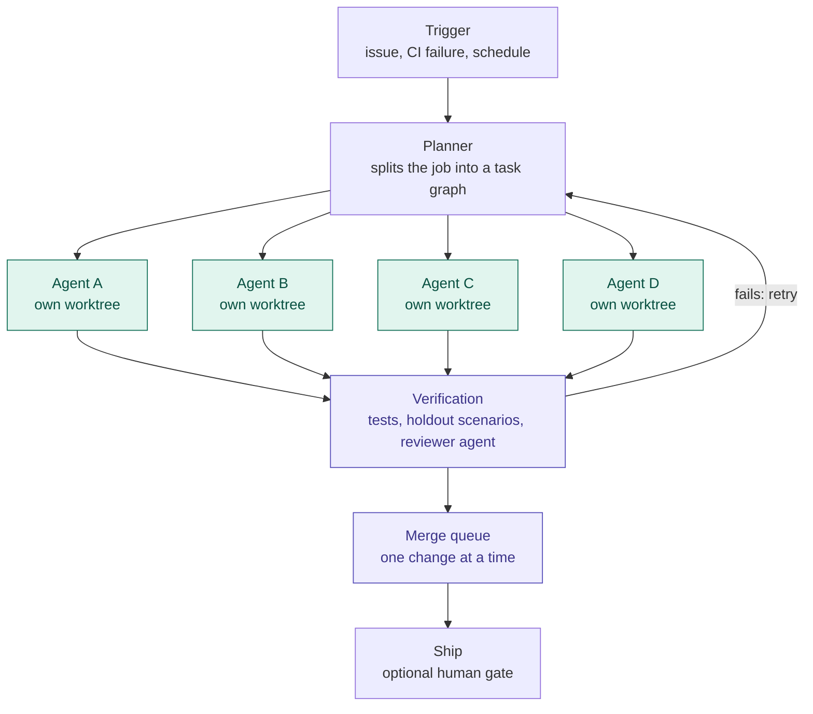
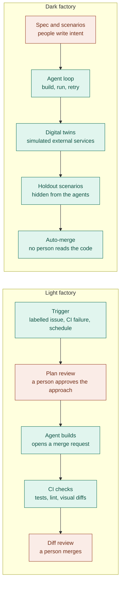
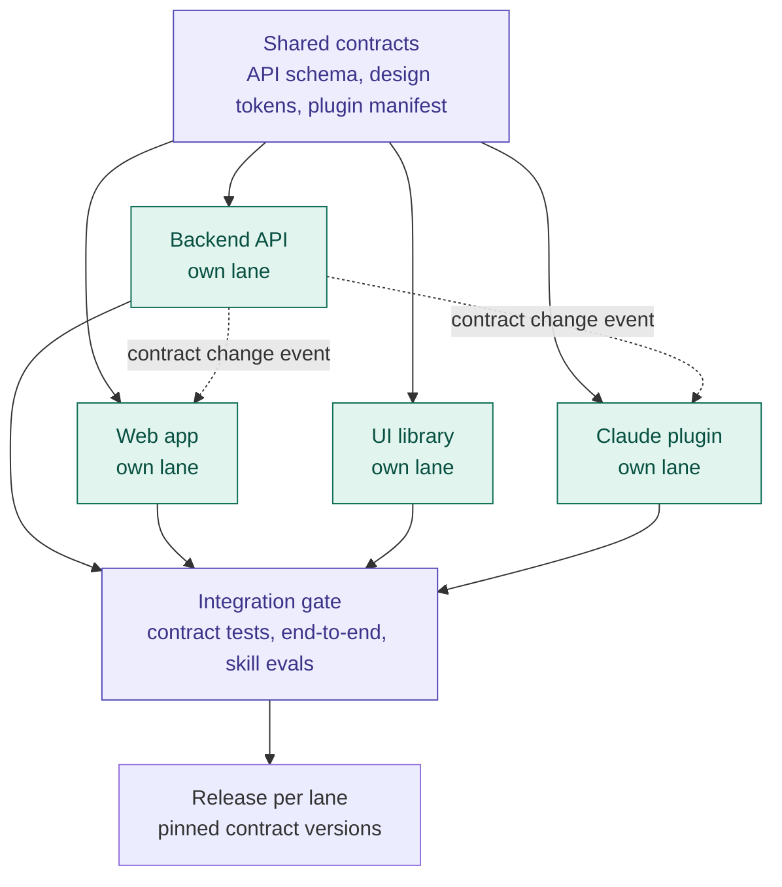
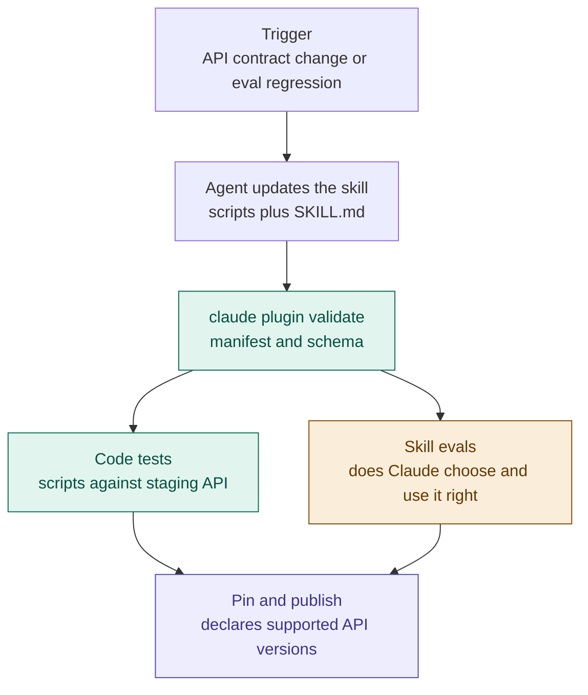

# Factory topologies, orchestrators and plugin lanes

Written 2026-10-30 from public sources, directly for this pack, so like `07` it has
no removed sections and no numbering gaps. It extends `01` §2.3 (published factory
models) and `07` §3 (one factory, many repositories) with four questions:

- whether an orchestrator such as Gas Town or Gas City is a different thing from a
  software factory, and whether it is outdated;
- where parallelism actually sits in a factory, and what caps it;
- what light and dark factories look like as pipelines;
- how to picture a product built from several layers in several repositories,
  including a Claude plugin whose skills carry real code and front real software.

Tags work as in the other files. Most claims here rest on search excerpts and
write-ups read on 2026-10-30, so most are [secondary]. The diagrams are Mermaid,
which GitLab and GitHub render; they are drawings of the ideas, not configuration.

## 1. What matters

1. **An orchestrator and a factory answer different questions.** An orchestrator
   answers "how do many agents work at once without trampling each other". A
   factory answers "what starts work without a person, and how do we know the
   output is right without reading it" [inferred from 1, 8, 9].
2. **Gas Town is superseded, by its own successor.** Gas Town (1 Jan 2026, `01`
   §2.3) was rebuilt as Gas City, an open-source orchestration-builder SDK that
   reached v1.0 around 24 April 2026 and describes itself as infrastructure for
   multi-agent software factories [1][2][6][7] [secondary]. Its repositories were
   still active in late October 2026 [2][3] [secondary]. No company case or
   outcome data was found on 2026-10-30; companies reach the factory model through
   vendors or their own central worker (`07` §3) [inferred].
3. **Parallelism lives in the middle of the pipeline only.** Agents fan out; the
   gates that decide whether work is trustworthy (verification, merge) are
   serial. Throughput is capped by those gates, not by agent count [inferred].
4. **Light and dark factories are the same pipeline with people in different
   places.** A dark factory moves human judgment upstream into specs and
   scenarios; it does not remove it [10] [secondary].
5. **Several layers in several repositories means several lanes, not one
   pipeline.** Each repository keeps its own factory lane; lanes coordinate only
   through versioned contracts and one shared integration gate. A contract
   change is an event that triggers the lanes downstream of it [inferred,
   extending `07` §3.1].
6. **A plugin whose skills carry code is a client lane with two kinds of
   correctness.** Its scripts must work against the real API, and Claude must
   choose and use its skills correctly. The first is ordinary testing; the second
   is evals, which `claude plugin eval` runs and can gate CI on [12] [secondary].
7. **At team scale the scarce resource is review.** More agents per engineer
   means more change requests into one shared review pool and merge queue.
   Reviewing plans before work starts is cheaper than reviewing diffs after
   [inferred].

## 2. Orchestrator or factory

### 2.1 Two definitions

- **Software factory.** A system of work where triggers, not a person, start
  coding-agent sessions: an issue created or labelled, a schedule, a CI failure
  or alert, or another session finishing. A factory removes the person from
  starting the session, not necessarily from any later step [8] [secondary].
- **Dark factory.** The limiting case: a factory, or part of one, whose output no
  person reviews. Unattended sessions whose merge requests a person still reviews
  are a factory, not a dark factory [8] [secondary].

Neither definition mentions how many agents run at once. A factory can run one
agent at a time and still be a factory [inferred].

### 2.2 Gas Town to Gas City

- **Gas Town** ran 20 to 30 parallel Claude Code sessions in fixed roles: a Mayor
  the person talks to, worker agents, monitors, and a merge role, on a git-backed
  task store and git worktrees (`01` §2.3) [13] [secondary]. Reported costs were
  high; one write-up cites about $100 an hour [13] [secondary].
- **Gas City** keeps the machinery and drops the fixed shape. It is an SDK built
  from composable primitives (agents, beads, formulas, rigs, packs, events), with
  declarative configuration in `city.toml`, a supervisor loop that reconciles
  desired to running state, and several runtime providers (tmux, subprocess,
  exec, ACP, Kubernetes, herdr) [2][4] [secondary]. Gas Town survives as one pack
  among many [3][13] [secondary].
- **Each repository is a rig.** A city adds the repositories agents work on as
  rigs and supports rig-scoped orchestration across several projects [2][3]
  [secondary]. That is the multi-repository shape of section 4, in Gas City's
  words.
- **Its v2 workflow engine is the parallel part.** A job is decomposed into units
  of work, ready units fan out to agents in parallel, each step waits on its
  dependencies, and failures are retried [4] [secondary]. The maintainers report
  running 30 or more agents per project on Gas City itself [5] [secondary,
  self-report].
- **What it is not.** Not a managed product, and not evidence that the approach
  works in a company: the public material is the maintainers' own and community
  write-ups [inferred].

### 2.3 Where parallelism sits

Green steps run in parallel; purple steps are serial. Adding agents widens the
green row and lengthens the purple queue. Past the point where verification and
merge are saturated, more agents mostly add conflicts and retries [inferred].
This is the same observation behind Symphony's three-to-five-session ceiling for
a supervising person (`01` §2.4).

## 3. Light and dark factories

Coral steps are people; green steps are machines.

- **Light factory.** People stay in the loop, trading speed for judgment and
  understanding [10] [secondary]. This is `07` §3.4 level 2, and every published
  company fleet in `07` §3.2 runs this way.
- **Dark factory.** StrongDM's version: specs and scenarios drive agents that
  converge without human review, scenarios kept as holdouts the agents cannot
  see, and simulated copies of the external services the software talks to
  (`01` §2.3) [9] [secondary]. The cost of not reading is comprehension debt: the
  gap between how much code exists and how much anyone understands [10]
  [secondary].
- **Vendor factories** take either shape, hosted. Factory.ai, the vendor that
  markets the category hardest, says its factories run at NVIDIA, Adobe and EY
  [11] [secondary, vendor claim].

## 4. Many layers, many repositories

A product is rarely one pipeline into one deployable. It is layers (a backend, a
web app, a shared UI library, a plugin) in separate repositories with separate
stacks and release rhythms. Picturing one factory for all of it fails. Picture a
lane per repository instead, joined by a thin shared layer [inferred].

Green is per repository and runs in parallel; purple is shared and serial. The
four lanes are an example, not a recommendation.

- **This is `07` §3.1 with the missing piece named.** `07` puts the worker and
  the rules in a central control plane and keeps build, test and deploy per
  repository. What lets per-repository lanes stay independent is a contract
  between them: a versioned API schema, a component and token API for the UI
  library, a plugin manifest that states which API versions it supports. Without
  contracts, every change needs a person to coordinate lanes by hand [inferred].
- **Factories chain through triggers.** A backend change that touches the API
  schema is an event, and the event starts sessions in the lanes that consume
  it. This is the "another session finishing" trigger of section 2.1, crossing a
  repository boundary [inferred from 8].
- **One integration gate, not one pipeline.** The only serial step shared by all
  lanes is the gate that runs contract tests, end-to-end tests and skill evals
  against a shared staging environment. Each lane still releases on its own,
  pinned to the contract versions the gate passed [inferred].
- **Own the contracts layer before the factories.** Deciding what goes in it and
  who approves changes to it is the architecture work; the lanes are routine
  once it exists [inferred].

## 5. A plugin as its own lane

A plugin whose skills carry real code (scripts, an MCP server, API clients) and
act as the interface to real software is a client of that software, like the
web app. It gets its own lane. What makes it hard to picture is that it has two
kinds of correctness at once [inferred].

Green checks are deterministic; amber is probabilistic; purple is the contract.

- **Evals are the plugin's test suite for behavior.** Code tests cannot tell you
  that a reworded skill description makes Claude pick the wrong skill.
  `claude plugin eval` runs a plugin against cases (a realistic prompt plus
  graders such as a regex, a check that a tool was called, or a model-judged
  rubric), compares against a no-plugin baseline, and can gate CI on the score
  [12] [secondary]. It shipped in Claude Code v2.1.269 on 11 September 2026 [12]
  [secondary]. `claude plugin validate` is the separate check for file syntax
  and schema [12] [secondary].
- **Eval runs cost money.** They call the model with your credentials and count
  against plan limits or API billing [12] [secondary]. Budget them like CI
  minutes (`07` §4).
- **The plugin pins the API versions it supports** and never assumes the latest,
  so a backend change cannot silently break it [inferred].
- **Run the skill evals in the shared integration gate too**, against staging,
  so a backend change that breaks the plugin's behavior fails before release
  [inferred].
- Distribution and admin control of plugins stay in `05` §2.6.

## 6. At team scale

All [inferred], grounded in sections 2 to 5 and `07` §3.4 and §5.

- **Review capacity is the bottleneck.** Several agents per engineer multiply
  change requests into one review pool. Measure review time per agent change
  before scaling agent count (guide §5).
- **Conflicts grow faster than agent count.** Clear ownership by module or
  feature area and small, scoped tasks matter more than the orchestrator.
- **Choose the human gates as a team.** Plan review upstream scales better than
  diff review downstream, and it is where a dark factory keeps its people.
- **Automated verification first.** Flaky or thin tests turn every agent change
  into a manual review. For a frontend that usually means end-to-end and visual
  regression tests before more agents.
- **Order.** Light factory on existing CI, one task class, human merge (`07` §3.4
  level 2). Add a contracts layer and the integration gate as soon as a second
  repository joins. Consider an orchestrator such as Gas City only when queue
  data shows coordination, not capacity, is the constraint (`07` §5 step 6).

## Sources

1. Steve Yegge, "Welcome to Gas City", Medium, April 2026. https://steve-yegge.medium.com/welcome-to-gas-city-57f564bb3607
2. gastownhall/gascity repository README, read via search excerpt 2026-10-30. https://github.com/gastownhall/gascity
3. gastownhall/gascity-packs repository README, read via search excerpt 2026-10-30. https://github.com/gastownhall/gascity-packs
4. tomrochette.com, "Gas City" research note (AI-generated, per its tags), October 2026. https://tomrochette.com/agents/orchestration/gascity/
5. Chris Sells, post on X about Gas City, 2026. https://x.com/csells/status/2044888565814010204
6. shahshrey, "Awesome Gas City" list. https://github.com/shahshrey/awesome-gas-city
7. Sébastien Dubois, "Gas City" note, 2026. https://www.dsebastien.net/gas-city/
8. Matt Pocock, AI Coding Dictionary (aicodingdictionary.com), entries "software factory" and "dark factory", as summarised by Envisioning. https://www.envisioning.com/vocab/software-factory.md ; https://www.envisioning.com/vocab/dark-factory.md
9. Simon Willison, "How StrongDM's AI team build serious software without even looking at the code", 7 Feb 2026. https://simonwillison.net/2026/Feb/7/software-factory
10. Addy Osmani, "Software Factories, Light and Dark", 20 Jul 2026. https://addyosmani.com/blog/software-factories/
11. Brandon Waselnuk, "What Is an AI Software Factory? A Buyer's Guide (2026)", Unblocked, 2 Aug 2026 (cites Factory.ai). https://getunblocked.com/blog/what-is-an-ai-software-factory-buyers-guide/
12. Anthropic, Claude Code plugin evals documentation. https://code.claude.com/docs/en/plugin-evals.md ; release date (secondary): https://www.aicodex.to/articles/claude-code-plugin-eval
13. bristanback.com, "The Multi-Agent Moment" (Gas Town roles and costs, April 2026 update). https://bristanback.com/posts/multi-agent-moment/
